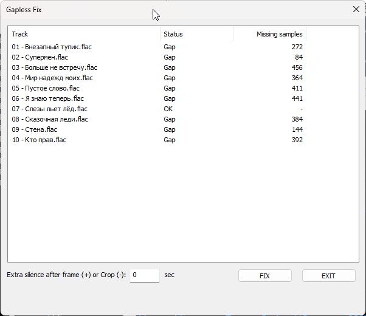
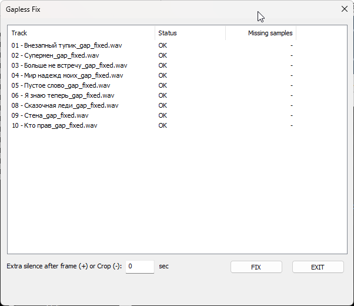

# Gapless Fix for foobar2000

[English](#english) | [Русский](#русский)

---

### Screenshots

**Before — tracks with uneven CD frames:**

**After — all frames aligned to 588 samples:**

---

## English

**Gapless Fix** is a foobar2000 component that fixes lossless CD rips with incomplete audio frames. If a track was ripped without proper padding, its length in samples may not be a multiple of **588** (one CD sector, 1/75 of a second).

The component analyzes selected tracks, reports which ones have incomplete frames, and writes corrected **WAV** files with the missing silence appended. Tags and album art are preserved.

### Features

- Analyzes any number of selected tracks and shows a report table:
  - **OK** — length already a multiple of 588
  - **Gap** — length not a multiple of 588, shows how many samples are missing
  - **Unsupported** — not 16-bit / 44.1 kHz, ignored
- Writes corrected WAV files with the exact number of silent samples needed to complete the last frame.
- Optional extra silence after the corrected frame (`+N` seconds) or cropping of trailing silence (`-N` seconds) — useful for fixing over-mastered concert discs with accidental 2-second gaps.
- Preserves tags and album art (front, back, disc, icon, artist).
- Strips stale `LENGTH` / `TLEN` tags from the output, so players rely on the physical file length.
- Optionally writes results to a subfolder (configurable in **Preferences → Advanced → Tools → Gapless Fix**).
- Adds the resulting files to the active playlist after completion.
- Runs fully in the background with a progress dialog; does not block foobar2000.

### Usage

1. Select one or more lossless tracks (FLAC, WAV, ALAC, etc.) from an album.
2. Right-click → **Utilities → Gapless Fix**.
3. Wait for the analysis progress to complete.
4. In the dialog that appears, review the status of each track.
5. Optionally set the extra silence or crop value in seconds:
   - `0` — only fix incomplete frames
   - `+N` — fix frames and append `N` seconds of silence to each track
   - `-N` — fix frames and crop `N` seconds from the end of each track
6. Click **FIX**. The corrected WAV files will be written next to the originals (or into a subfolder if enabled).

### Settings

**Preferences → Advanced → Tools → Gapless Fix:**

- **Create subfolder for output** — write corrected files into a subfolder instead of next to the originals.
- **Subfolder name** — name of that subfolder (default: `gap_fixed`).

### Notes

- Only **16-bit / 44.1 kHz** tracks are processed. Other formats are marked as *Unsupported* and skipped — this is intentional, since the 588-sample frame size is specific to audio CD.
- The component does not modify the originals. Corrected files are always written separately with the `_gap_fixed` suffix.
- If an operation is aborted, the incomplete WAV file is removed automatically.

### Building from source

1. Clone this repository.
2. Clone the foobar2000 SDK, `pfc`, `libPPUI`, and WTL next to the project folder.
3. Open `foo_gapless.slnx` in Visual Studio.
4. Set the include paths (`foobar2000`, `foobar2000/SDK`, `foobar2000/helpers`, `pfc`, `libPPUI`, `WTL/Include`) and link `winmm.lib` and `comctl32.lib`.
5. Build for `x86` or `x64`, `Release` configuration.
6. Copy the resulting `foo_gapless.dll` to `foobar2000/components/`.

### License

MIT

---

## Русский

**Gapless Fix** — компонент для foobar2000, который исправляет lossless-рипы с CD, имеющие неполные аудиофреймы. Если трек был рипнут без правильного дополнения тишиной, его длина в сэмплах может не быть кратной **588** (один CD-сектор, 1/75 секунды).

Компонент анализирует выбранные треки, показывает, у каких из них неполные фреймы, и записывает исправленные **WAV**-файлы с дописанной недостающей тишиной. Теги и обложки сохраняются.

### Возможности

- Анализирует любое количество выбранных треков и показывает таблицу результатов:
  - **OK** — длина уже кратна 588
  - **Gap** — длина не кратна 588, показано, сколько сэмплов не хватает
  - **Unsupported** — не 16 бит / 44.1 кГц, игнорируется
- Записывает исправленные WAV-файлы с точным числом тихих сэмплов, необходимых для завершения последнего фрейма.
- Опционально добавляет дополнительную тишину после выровненного фрейма (`+N` секунд) или обрезает тишину в конце (`-N` секунд) — полезно для исправления криво смастеренных концертных дисков со случайными 2-секундными паузами.
- Сохраняет теги и обложки (front, back, disc, icon, artist).
- Удаляет устаревшие теги `LENGTH` / `TLEN` из выходного файла, чтобы плееры опирались только на физическую длину.
- Опционально записывает результаты в подпапку (настраивается в **Preferences → Advanced → Tools → Gapless Fix**).
- Добавляет получившиеся файлы в активный плейлист после завершения.
- Работает в фоне с окном прогресса, не блокирует foobar2000.

### Использование

1. Выделите один или несколько lossless-треков (FLAC, WAV, ALAC и т.д.) из альбома.
2. Правый клик → **Utilities → Gapless Fix**.
3. Дождитесь завершения анализа.
4. В появившемся окне проверьте статус каждого трека.
5. При необходимости укажите значение дополнительной тишины или обрезки в секундах:
   - `0` — только исправить неполные фреймы
   - `+N` — исправить фреймы и дописать `N` секунд тишины к каждому треку
   - `-N` — исправить фреймы и обрезать `N` секунд с конца каждого трека
6. Нажмите **FIX**. Исправленные WAV-файлы будут записаны рядом с оригиналами (или в подпапку, если включено).

### Настройки

**Preferences → Advanced → Tools → Gapless Fix:**

- **Create subfolder for output** — записывать исправленные файлы в подпапку, а не рядом с оригиналами.
- **Subfolder name** — имя этой подпапки (по умолчанию: `gap_fixed`).

### Примечания

- Обрабатываются только треки **16 бит / 44.1 кГц**. Остальные форматы помечаются как *Unsupported* и пропускаются — это сделано намеренно, так как размер фрейма 588 сэмплов специфичен именно для Audio CD.
- Компонент не изменяет оригиналы. Исправленные файлы всегда записываются отдельно с суффиксом `_gap_fixed`.
- Если операция была отменена, недописанный WAV-файл удаляется автоматически.

### Сборка из исходников

1. Клонируйте этот репозиторий.
2. Клонируйте foobar2000 SDK, `pfc`, `libPPUI` и WTL рядом с папкой проекта.
3. Откройте `foo_gapless.slnx` в Visual Studio.
4. Настройте пути к заголовкам (`foobar2000`, `foobar2000/SDK`, `foobar2000/helpers`, `pfc`, `libPPUI`, `WTL/Include`) и подключите `winmm.lib` и `comctl32.lib`.
5. Соберите для `x86` или `x64` в конфигурации `Release`.
6. Скопируйте получившийся `foo_gapless.dll` в `foobar2000/components/`.

### Лицензия

MIT